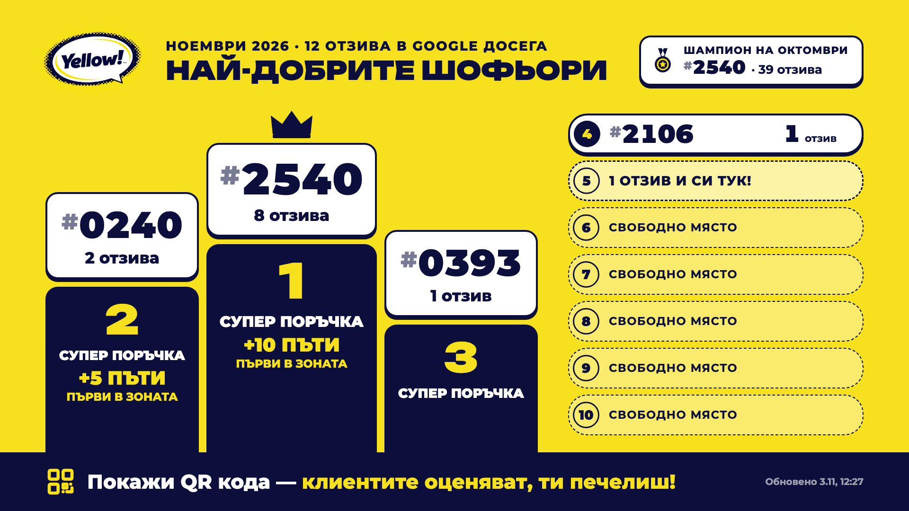

# Yellow! Lobby TV

Страница за телевизорите във фоайето: върти YouTube клипа и след всяко завъртане показва за 10 секунди класацията на шофьорите по Google отзиви от Ratestar.

- **Линкът за телевизорите не се сменя никога.** Сменят се само данните зад него.
- **Класацията се обновява сама всеки час от ~6 до ~22 ч.** (GitHub Actions → `.github/workflows/update.yml`).

## Настройки през самия линк

| Параметър | Пример | Какво прави |
|---|---|---|
| `slide` | `?slide=15` | секунди на класацията (по подразбиране 15) |
| `how` | `?how=5` | секунди на слайда „Кажи на клиента“ преди класацията (по подразбиране 13; `?how=0` го спира) |
| `every` | `?every=2` | слайдовете след всяко 2-ро завъртане на клипа (по подразбиране след всяко) |
| `clip` | `?clip=XXXXXXXXXXX` | друг YouTube клип (ID-то от линка) |
| `mode` | `?mode=slide` / `?mode=how` | само класацията / само „Кажи на клиента“, без клипа (за преглед) |
| `today` | `?mode=slide&today=2026-11-12` | преглед как изглежда класацията в друг ден от седмицата |

Наградите за топ 3 се сменят в `PRIZES` в началото на скрипта в `site/index.html`.
Класацията е **седмична**: брои отзивите от понеделник 00:00 (софийско време) до момента и започва отначало всеки понеделник.
Горе вдясно — колко дни остават; долу вдясно — победителят от миналата седмица.
Промени по самата страница стигат до телевизорите до час (страницата проверява за нова версия и се презарежда след клипа).

## Паролата за Ratestar

Роботът влиза в Ratestar с два secret-а в GitHub: **Settings → Secrets and variables → Actions**:
`RATESTAR_EMAIL` и `RATESTAR_PASSWORD`. Паролата не е в кода.

## Резервно обновяване от Mac-а

GitHub често пуска своя график с часове закъснение, затова Mac-ът на Калоян казва на GitHub да пусне робота
всеки час в :40 между 7 и 22 ч. (`scripts/mac-refresh.sh`, launchd агент `com.yellow.lobby-tv.refresh`).
Работи само докато Mac-ът е включен; дневник: `~/Library/Logs/yellow-lobby-tv-refresh.log`.
Спиране: `launchctl bootout gui/$(id -u)/com.yellow.lobby-tv.refresh`

## Ръчно обновяване

GitHub → **Actions → „Класация от Ratestar“ → Run workflow**.
Ако обновяването се провали, на телевизора остава последната успешна класация, а GitHub праща имейл.
