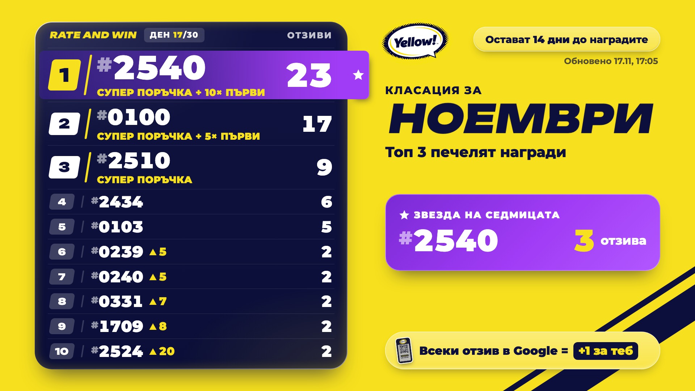

# Yellow! Lobby TV

Страница за телевизорите във фоайето: върти YouTube клипа и след всяко завъртане показва три слайда във вида на
месечния пост („F1 timing tower“ в тъмно стъкло върху жълто):

1. **„Кажи на клиента“** (11 сек) — какво да каже шофьорът и как се влиза в класацията.
2. **Класация на седмицата** (14 сек) — отзивите от понеделник 00:00 (софийско време) до момента. Без награди.
3. **Класация на месеца** (16 сек) — кулата се преобръща от седмицата към месеца: наградите за топ 3, кой се е качил и
   слязъл от понеделник насам и „Звездата на седмицата“ (първият в седмичната класация) с лилав ред, флагче ★ и карта вдясно.
   В първите 3 дни на месеца тук са „Шампионите на <миналия месец>“.

- **Линкът за телевизорите не се сменя никога.** Сменят се само данните зад него.
- **Класацията се обновява сама всеки час от ~6 до ~22 ч.** (GitHub Actions → `.github/workflows/update.yml`).
- Двете класации стоят неподвижно около 12 сек след анимацията си. В понеделник сутрин, докато няма нито един отзив,
  празната седмична класация стои само 6 сек.
- Старият вид (подиумът) е запазен на `v1.html`, ако някога потрябва.

## Настройки през самия линк

| Параметър | Пример | Какво прави |
|---|---|---|
| `how` | `?how=8` | секунди на „Кажи на клиента“ (по подразбиране 11; `?how=0` го спира) |
| `week` | `?week=20` | секунди на класацията на седмицата (по подразбиране 14; старото `slide` също работи) |
| `month` | `?month=20` | секунди на класацията на месеца (по подразбиране 16; `?month=0` я спира) |
| `every` | `?every=2` | слайдовете след всяко 2-ро завъртане на клипа (по подразбиране след всяко) |
| `clip` | `?clip=XXXXXXXXXXX` | друг YouTube клип (ID-то от линка) |
| `motion` | `?motion=0` | без движение (слаб телевизор). Страницата минава на това и сама, ако два пъти поред насича |
| `mode` | `?mode=loop` | преглед без клипа: `loop` (трите слайда), `how`, `week`, `month`, `board` |
| `t` | `?mode=month&t=3.5` | замразен кадър в тази секунда (за снимки) |
| `today` | `?mode=loop&today=2026-12-02` | преглед как изглежда в друг ден |

Наградите за топ 3 са в `PRIZES` в началото на скрипта в `site/index.html` (и в `site/post.html` за поста).
Месечните данни на живо са `monthLive` в `site/data/leaderboard.json` (смята ги роботът).
Кадри от анимациите за преглед: `scripts/tv-shots.py <папка> име="mode=month&t=3.5" … --sheet лист.png`.
Промени по самата страница стигат до телевизорите до час (страницата проверява за нова версия и се презарежда след клипа).

## Паролата за Ratestar

Роботът влиза в Ratestar с два secret-а в GitHub: **Settings → Secrets and variables → Actions**:
`RATESTAR_EMAIL` и `RATESTAR_PASSWORD`. Паролата не е в кода.

## Седмичният пост за „Аз и Yellow!“ (ФБ групата с шофьорите)

Всеки понеделник в 9:00 задача в Claude (desktop app → Scheduled → „Rate and Win — седмичен пост в Канва“)
прави пост 1080×1350 с **месечната** класация до неделя вечер във вид на „F1 timing tower“: една тъмна стъклена кула
с местата 1–10, наградите за месеца при топ 3 и ▲/▼/НОВ спрямо миналия понеделник (само при движение).
„Звездата на седмицата“ е като най-бързата обиколка във F1: целият ѝ ред е лилав, а отстрани на кулата стърчи лилав флаг с ★ и +N
(нищо не стои вътре до номера); какво значи лилавото казва чипът в лентата на кулата.
Когато месец е свършил — пост „Шампионите на <месец>“.
Постът отива като дизайн в Канва, папка **Rate and Win – седмични постове (Аз и Yellow!)**, а Claude дава и готов текст за поста.

- Данните: `monthPost` в `site/data/leaderboard.json` (смята ги роботът).
- Дизайнът: `site/post.html`; преглед: `scripts/render-post.sh out.png [demo-data/….json]`.
- Ръчно: `scripts/make-post.sh` → `posts/<дата>/post.png` и `post.pdf`.

Наградите са **месечни**: на телевизора се виждат само в класацията на месеца, никога до седмичната.

## Резервно обновяване от Mac-а

GitHub често пуска своя график с часове закъснение, затова Mac-ът на Калоян казва на GitHub да пусне робота
всеки час в :40 между 7 и 22 ч. (`scripts/mac-refresh.sh`, launchd агент `com.yellow.lobby-tv.refresh`).
Работи само докато Mac-ът е включен; дневник: `~/Library/Logs/yellow-lobby-tv-refresh.log`.
Спиране: `launchctl bootout gui/$(id -u)/com.yellow.lobby-tv.refresh`

## Ръчно обновяване

GitHub → **Actions → „Класация от Ratestar“ → Run workflow**.
Ако обновяването се провали, на телевизора остава последната успешна класация, а GitHub праща имейл.
